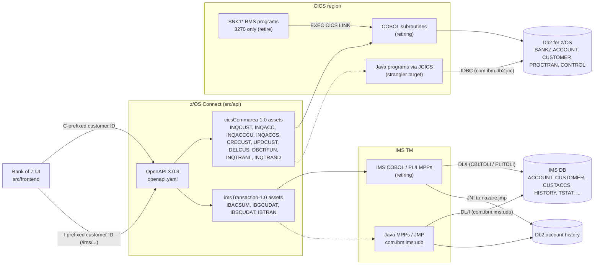

# COBOL to Java Migration Plan

This plan describes a phased, strangler-fig migration of the Bank of Z CICS and IMS COBOL programs in `src/base` to Java. Each phase replaces a small set of programs behind an unchanged interface, runs the new and old implementations side by side, and retires the COBOL version only after its exit criteria are met. At every point, the Bank of Z UI and the z/OS Connect API continue to work without change.

This document is a plan only. It does not change any source code, build configuration, or deployment definition.

## Scope

The plan covers the following assets.

| Area | Location | Contents |
|------|----------|----------|
| CICS business logic | `src/base/cics/cobol/` | Linked subroutines that hold the business logic and Db2 access (`INQCUST`, `INQACC`, `INQACCCU`, `INQACCS`, `CRECUST`, `CREACC`, `UPDCUST`, `UPDACC`, `DELCUS`, `DELACC`, `DBCRFUN`, `XFRFUN`, `INQTRANL`, `INQTRAND`, `CRDTAGY1`–`CRDTAGY5`, `GETCOMPY`, `GETSCODE`, `ABNDPROC`, `BANKDATA`) |
| CICS 3270 front end | `src/base/cics/cobol/BNK*.cbl`, `src/base/cics/bms/` | Pseudo-conversational BMS programs (`BNKMENU`, `BNK1CAC`, `BNK1CCA`, `BNK1CCS`, `BNK1CRA`, `BNK1DAC`, `BNK1DCS`, `BNK1TFN`, `BNK1UAC`) and their maps |
| CICS copybooks | `src/base/cics/copy/` | COMMAREA, container, Db2 host-variable, and BMS symbolic-map layouts |
| IMS business logic | `src/base/ims/cobol/` | Message processing programs (`IBTRAN`, `IBACSUM`, `IBGCUDAT`, `IBSCUDAT`, `IBLOGIN1`, `IBLOGOUT`) and DL/I load programs (`LOADCUST`, `LOADCUSA`, `LOADACCT`, `LOADHIST`, `LOADTSTA`) |
| IMS copybooks | `src/base/ims/copy/` | Message and segment layouts (`IBTRAN`, `IBGHIST`, `IBSHIST`) and the `JNI` interoperation copybook |
| IMS database definitions | `src/base/ims/DBD/`, `src/base/ims/PSB/`, `src/base/ims/LoadData/` | Nine HDAM/OSAM databases, program specification blocks, and seed data |
| IMS Java | `src/base/ims/java/` | Existing Java message processing (JMP) code in package `nazare.jmp` (for example `QueryTransaction` for transaction `IBGHIST` and `InsertHist`, which `IBTRAN` calls through JNI) |
| PL/I | `src/base/ims/pli/IBLOGIN.pli`, `src/base/batch/pli/BNKSTMT.pli` | IMS login program and the batch statement report |
| Batch | `src/base/batch/jcl/BNKSTMT.jcl` | TSO batch (`IKJEFT01`, `DSN RUN`) job for `BNKSTMT`, plan `BANKZPLN` |
| API contract | `src/api/` | z/OS Connect OpenAPI document (`src/main/api/openapi.yaml`), operations, and `zosAssets` |
| Frontend | `src/frontend/` | Browser UI that calls z/OS Connect |

## Target architecture

The diagram shows the request path that must stay stable throughout the migration. During a phase, a migrated program runs next to its COBOL equivalent inside the same CICS region or IMS system, so the z/OS Connect `zosAssets` do not need to change.

Dashed arrows show the routes that are switched over program by program.

## Migration principles

- **Interface first.** Every migrated program keeps its existing entry point: the same CICS program name and COMMAREA or container layout, or the same IMS transaction code and message layout. z/OS Connect, the UI, and any remaining COBOL callers cannot tell which implementation answered.
- **One program at a time.** Each program has its own switch, its own parallel run, and its own rollback.
- **Byte-identical records.** Output records are compared byte for byte, in EBCDIC, against golden files. A difference that is "only formatting" is still a failure.
- **No behavior fixes during migration.** Existing defects are migrated as they are and logged separately. For example, `XFRFUN` does not check the available balance, and `IBTRAN` withdrawals have no balance check. Fixing these during the migration would make the parallel-run comparison meaningless.
- **Source code is frozen per program.** While a program is in parallel run, its COBOL source and copybooks change only for production fixes, and each fix is applied to both implementations.

## Phase 0: Baseline

Phase 0 builds the safety net. No production code changes in this phase.

### Golden record capture

Capture input and output records for every linked subroutine, covering successful paths, business rejections, and abend paths.

| Program | Interface | Called by | Paths to capture |
|---------|-----------|-----------|------------------|
| `INQCUST` | COMMAREA (`INQCUSTZ`) | API `GET /customers/{customerId}`, `BNK1DCS` | Found, not found, "last customer" key `9999999999`, abend `CVR1`, rollback abend `HROL` |
| `INQACC` | COMMAREA (`INQACC`) | API `GET /accounts/{accountId}`, `GET /accounts/{accountId}/balances`, `BNK1DAC`, `BNK1UAC` | Found, not found, "last account" key `99999999`, abend `HRAC`, `HROL` |
| `INQACCCU` | COMMAREA (`INQACCCU`) | API `GET /customers/{customerId}/accounts`, `DELCUS`, `CREACC` | Zero, one, and many accounts; customer not found |
| `INQACCS` | COMMAREA (`INQACCSZ`) | API `GET /accounts` | Empty and populated result sets |
| `UPDCUST` | COMMAREA (`UPDCUST`) | API `PUT /customers/{customerId}`, `BNK1DCS` | Valid update, invalid title, not found. `UPDCUST` never updates the created date or credit score. |
| `UPDACC` | COMMAREA (`UPDACC`) | `BNK1UAC` only | Valid update (type, interest rate, and overdraft only), not found |
| `DELACC` | COMMAREA (`DELACC`) | `BNK1DAC` only | Deleted, not found, `PROCTRAN` write failure |
| `DELCUS` | COMMAREA (`DELCUS`) | API `DELETE /customers/{customerId}`, `BNK1DCS` | Customer with and without accounts (accounts are deleted before the customer), not found, partial failure |
| `CRECUST` | COMMAREA (`CRECUST`) | API `POST /customers`, `BNK1CCS` | Created, credit check time-out, `ENQ` on the customer-number counter, abend paths |
| `CREACC` | COMMAREA (`CREACC`) | `BNK1CAC` only | Created, invalid type, customer not found, customer already has 10 accounts, `ENQ` on the account-number counter |
| `DBCRFUN` | COMMAREA (`PAYDBCR`) | API `POST /accounts/{accountId}/deposit`, `BNK1CRA` | Credit, debit, insufficient funds for payments (`COMM-FACILTYPE` 496), payment from or into `MORTGAGE` and `LOAN`, `PROCTRAN` insert failure, `HROL` |
| `XFRFUN` | COMMAREA (`XFRFUN`) | `BNK1TFN` only | Transfer, amount of zero or less, same account (`SAME`), from or to account not found (`FROM`, `TO  `), Db2 deadlock `-911` retry, rollback failure (`HROL`, `RUF2`) |
| `INQTRANL` | COMMAREA (`INQTRANL`) | API `GET /accounts/{accountId}/transactions` (transaction `ITRL`) | Empty, single page, multiple pages, abend `ITRL` |
| `INQTRAND` | COMMAREA (`INQTRAND`) | API `GET /accounts/{accountId}/transactions/{transactionId}` (transaction `ITRD`) | Found, not found, abend `ITRD` |
| `CRDTAGY1`–`CRDTAGY5` | Channel `CIPCREDCHANN`, containers `CIPA`–`CIPE` | `CRECUST` through `EXEC CICS RUN TRANSID(OCR1`–`OCR5)` | Normal reply, reply after the `CRECUST` time-out, container read failure |

> **Note:** `CRDTAGY1`–`CRDTAGY5` do not use a COMMAREA. They are started asynchronously and exchange data through containers on channel `CIPCREDCHANN`, so their golden files are container images. Their credit scores are generated with `FUNCTION RANDOM` after a random `EXEC CICS DELAY`, so capture them with a fixed seed or compare only the record structure and value range.

Capture rules:

- Record the raw EBCDIC bytes (CCSID 037, as set in each `zosAsset.yaml`) for the COMMAREA or container on entry and on return, together with the Db2 rows that the program reads or changes before and after the call.
- Record the abend code, the `ABNDPROC` record (`ABNDINFO` layout), and whether the unit of work was committed or rolled back.
- Store the golden files outside `src/base`, so they are not picked up by DBB impact analysis.

### API contract freeze

- Freeze `src/api/src/main/api/openapi.yaml`, the operation mappings in `src/api/src/main/operations/`, and the generated request and response copybooks in `src/api/src/main/zosAssets/*/providerFiles/gen/`.
- Add a check that fails the build if any file under `zosAssets/*/providerFiles/gen/` changes. If these generated copybooks stay the same, z/OS Connect keeps building byte-identical COMMAREAs and IMS messages.
- The following programs are exposed through z/OS Connect today:

| API operation | Backend |
|---------------|---------|
| `GET /customers/{customerId}` | CICS `INQCUST` |
| `PUT /customers/{customerId}` | CICS `UPDCUST` |
| `DELETE /customers/{customerId}` | CICS `DELCUS` |
| `POST /customers` | CICS `CRECUST` |
| `GET /customers/{customerId}/accounts` | CICS `INQACCCU` |
| `GET /accounts` | CICS `INQACCS` |
| `GET /accounts/{accountId}`, `.../balances` | CICS `INQACC` |
| `POST /accounts/{accountId}/deposit` | CICS `DBCRFUN` |
| `GET /accounts/{accountId}/transactions` | CICS `INQTRANL` |
| `GET /accounts/{accountId}/transactions/{transactionId}` | CICS `INQTRAND` |
| `GET /ims/customers/{customerId}` | IMS `IBGCUDAT` |
| `PUT /ims/customers/{customerId}` | IMS `IBSCUDAT` |
| `GET /ims/customers/{customerId}/accounts`, `GET /ims/accounts/{accountId}`, `.../balances` | IMS `IBACSUM` |
| `POST /ims/accounts/{customerId}/{accountId}/deposit` | IMS `IBTRAN` |

`XFRFUN`, `UPDACC`, `CREACC`, and `DELACC` are not exposed through the API. They are reached only from the BMS programs. This affects Phase 2 and Phase 4.

### Data type catalog

Build a field-level catalog from every copybook in `src/base/cics/copy` and `src/base/ims/copy`, and use the following mapping rules in all phases.

| COBOL definition | Where it is used | Java type | Rule |
|------------------|------------------|-----------|------|
| `PIC X(n)` | Names, addresses, eye-catchers, flags | `String` (fixed length) | Pad with EBCDIC spaces (`0x40`) to exactly `n` bytes. Do not trim on the way in. Truncate on the way out. |
| `PIC 9(n)` (`DISPLAY`) | Customer numbers `9(10)`, account numbers `9(8)`, sort codes `9(6)`, dates `9(8)` | `long`/`int`, or `String` for keys | Keep leading zeros. Keys stay zero-padded strings because the Db2 columns are `CHAR(n)`. |
| `PIC S9(n)V99` (`DISPLAY`) | COMMAREA amounts and balances, for example `COMM-AMT`, `COMM-AV-BAL` in `PAYDBCR` and `XFRFUN` | `BigDecimal`, scale 2 | Zoned decimal with an overpunched sign in the last byte (`C`/`D`/`F` zone). Encoding must produce the same sign nibble that COBOL writes. |
| `PIC 9(4)V99` | `ACCOUNT-INTEREST-RATE` | `BigDecimal`, scale 2 | Unsigned zoned decimal |
| `PIC S9(n)V99 COMP-3` | Db2 host variables in CICS programs (`HV-ACCOUNT-AVAIL-BAL`, `HV-PROCTRAN-AMOUNT`), IMS `AMOUNT` and `BALANCE-AS` `S9(13)V9(2)` | `BigDecimal` | Packed decimal. Preferred sign nibble `C` (positive) and `D` (negative). Accept `F` on read. |
| `PIC S9(15) COMP-3` | `WS-U-TIME`, `ABND-UTIME-KEY` | `long` | Packed decimal `ABSTIME` value |
| `PIC S9(4) COMP`, `S9(8) COMP`, `S9(8) BINARY` | BMS field lengths, `COMM-FACILTYPE`, `NUMBER-OF-ACCOUNTS` | `short` / `int` | Big-endian binary. COBOL `TRUNC` compiler option decides whether values beyond the `PIC` digit count are kept, so confirm the `TRUNC` setting used by the DBB COBOL build (`.setup/build/languages/Cobol.yaml` and the compiler defaults). |
| `PIC 9(4) COMP` | IMS `LL`/`ZZ` message prefixes | `int` (unsigned 16-bit) | Big-endian, unsigned |
| `PIC S9(18) COMP-5` | IMS `TXID`, `REFTXID`, `ACCID` | `long` | Native binary, not truncated to `PIC` digits |
| `REDEFINES` | Dates split into day, month, and year (`ACCOUNT-OPENED-GROUP`), `BAL` over `MSG-OUT` in `IBTRAN` | Accessor methods on one byte buffer | Model as views over the same bytes, not as separate fields |
| `OCCURS` | Account lists in `INQACCCU`, `INQACCS`, `DELACCZ`, `INQTRANL` | Fixed-size array | Unused entries must keep their initialized bytes (spaces or zeros), not `null` |
| Edited pictures, for example `Z(13).99` | `BALANCE-ZONED1` in `IBTRAN` | `String` | Format exactly as COBOL does: leading spaces, period as the decimal separator |

Known type differences to record in the catalog:

- CICS Db2 balances are `DECIMAL(12,2)` (DDL in `.setup/jcl/cics/Db2-create.j2`). The IMS path uses `S9(13)V99` and `DECIMAL(15,2)`.
- The `ACCDB2` copybook declares `DECIMAL(4,2)` and `DECIMAL(10,2)`, but the DDL creates `DECIMAL(6,2)` and `DECIMAL(12,2)`. The Java mapping must follow the DDL, and the difference must be recorded.
- `CUSTOMER` dates (date of birth, created date, credit score review date) are stored as `INTEGER` values in `YYYYMMDD` form.

### Routing rule

The Bank of Z UI selects the backend from the customer ID prefix. The rule is implemented in `src/frontend/js/utils.js` (`parseCustomerId`, `validateCustomerId`) and `src/frontend/js/api.js`.

| Customer ID | Rule | Backend | API path |
|-------------|------|---------|----------|
| `C` followed by one or more digits, for example `C1234` | Digits only after the prefix | CICS | `/customers/...`, `/accounts/...` |
| `I` followed by exactly nine digits, for example `I000000015` | Exactly nine digits | IMS TM | `/ims/customers/...`, `/ims/accounts/...` |

In `api.js`, any ID that does not start with `I` is sent to CICS. The migration must not change this rule. Because both stacks stay behind the same API paths, the routing is not affected by which implementation answers.

### Phase 0 risks

- **Incomplete coverage.** Golden files that cover only successful paths give false confidence in later phases. Abend and rollback paths are the most valuable captures.
- **Nondeterminism.** `CRDTAGY1`–`CRDTAGY5` use random values and delays. `CRECUST` depends on a time-out. Timestamps from `ASKTIME` change on every run. These fields must be masked by name in the comparison, not ignored as a whole record.

### Phase 0 exit criteria

- Golden files exist for every program in the capture table, including at least one abend path for each program that issues `EXEC CICS ABEND`.
- The data type catalog covers 100% of the fields in the COMMAREA, container, and IMS message copybooks, and has been reviewed by a COBOL developer.
- The API contract check is in place and passes.
- The regression harness (see [Cross-cutting controls](#cross-cutting-controls)) replays all golden files against the current COBOL programs without differences.

## Phase 1: Pilot with thin subroutines

**Programs:** `CRDTAGY1`–`CRDTAGY5`, `INQCUST`, `INQACC`

These programs are read-only or nearly stateless, have small interfaces, and do not move money. They prove the toolchain, deployment, and comparison process.

### Approach

- Implement each program as a Java CICS program that uses the JCICS API (`com.ibm.cics.server`) and is defined in CICS under the same program name. COBOL callers and z/OS Connect keep using `EXEC CICS LINK` with the same COMMAREA, or `RUN TRANSID` with the same channel.
- Read and write the COMMAREA or container as a byte array, and use generated record classes based on the data type catalog. Do not use a JSON or object-mapping layer between the byte array and the business logic.
- Access Db2 through JDBC with `com.ibm.db2:jcc`, which is already a dependency in `src/base/ims/java/build.gradle`. In CICS, use the connection provided by the CICS Db2 attachment (JDBC type 2, `jdbc:default:connection`), so the Java Db2 work stays in the CICS unit of work and is committed or rolled back by CICS syncpoint.
- Create the CICS Java code as a separate Gradle project. Do not add it to the IMS JMP project: the IMS project is built by the DBB IMS Java builder and deployed as the `nazare-ims-jmp` JAR.
- Keep the special key values used by the COBOL programs: `9999999999` in `INQCUST` and `99999999` in `INQACC` mean "return the last record".
- Raise the same abend codes as the COBOL programs (`CVR1`, `HRAC`, `HROL`) with `Task.abend()`, and link to `ABNDPROC` with the same `ABNDINFO` record before the abend.
- For `CRDTAGY1`–`CRDTAGY5`, keep the simulated delay and random score unless the business decides to replace the simulation with a real credit agency integration. That decision is out of scope for this plan.

### Phase 1 risks

- **Low exposure.** Errors return incorrect read results but do not change balances.
- **Abend parity.** z/OS Connect maps CICS abends to HTTP 500. A Java exception that is not turned into the expected abend code produces a different error, even if the result is the same.
- **JVM server capacity.** Java start-up and garbage collection pauses can push `CRECUST` beyond its credit check wait time, which changes customer creation results.

### Phase 1 exit criteria

- All Phase 0 golden files for the pilot programs pass against the Java implementations.
- The parallel run (see [Divergence logging](#divergence-logging-during-parallel-runs)) shows zero unexplained differences over an agreed period and volume.
- Rollback to COBOL has been rehearsed for each program, within the agreed time limit.
- Response time at the 95th percentile is within an agreed margin of the COBOL baseline.

## Phase 2: Money movement

**Programs:** `UPDACC`, `UPDCUST`, `DBCRFUN`, `XFRFUN`

These programs change balances or customer master data. Behavior parity is mandatory.

### Unit-of-work mapping

| COBOL behavior | Java equivalent |
|----------------|-----------------|
| Implicit syncpoint at task end | Let CICS commit at task end. Do not call `commit()` on the JDBC connection. |
| `EXEC CICS SYNCPOINT` | `Task.getTask().commit()` (JCICS) |
| `EXEC CICS SYNCPOINT ROLLBACK` | `Task.getTask().rollback()` (JCICS) |
| `EXEC CICS ABEND ABCODE(x)` | `Task.getTask().abend(x)`. The CICS abend backs out the unit of work, as in COBOL. |
| `EXEC CICS ASSIGN ABCODE` and `HANDLE ABEND` logic in `DBCRFUN`, `INQACC` | An exception handler that reads the abend code and runs the same compensation steps |
| `XFRFUN` deadlock handling: on `SQLCODE -911`, roll back, wait 1 second (`EXEC CICS DELAY`), retry up to 5 times | Same retry loop with the same limit and delay, on `SQLException` with error code `-911` |

Do not use container-managed or Spring-style transactions that start a separate JDBC transaction. The Db2 updates and the `PROCTRAN` insert must stay in the same CICS unit of work as in the COBOL programs, so that a failed `PROCTRAN` insert also backs out the balance update.

### Decimal parity

- Use `BigDecimal` for every amount and balance, with the scale taken from the `PIC` clause (scale 2 for all current amount fields).
- COBOL truncates by default when a result has more decimal places than the receiving field, unless `ROUNDED` is coded. Use `RoundingMode.DOWN` by default, and `RoundingMode.HALF_UP` only where the COBOL statement specifies `ROUNDED`. Check every `COMPUTE`, `ADD`, and `SUBTRACT` statement.
- COBOL silently drops high-order digits on overflow if `ON SIZE ERROR` is not coded. Java must reproduce this or the difference must be approved and recorded. For example, a `S9(10)V99` field overflows above 9,999,999,999.99.
- Never use `double` or `float`, including in logging and comparison code.

### `XFRFUN` caller

`XFRFUN` is called only from `BNK1TFN` (3270). There is no API operation for transfers. Before parallel run, decide one of the following:

1. Add a z/OS Connect operation for `XFRFUN`. This changes the frozen API contract and needs a separate contract review.
2. Keep `BNK1TFN` until `XFRFUN` has been migrated, and run the parallel comparison through it. This moves part of the Phase 4 retirement until after Phase 2.

The same choice applies to `UPDACC` (called only from `BNK1UAC`).

### Parallel run

- Run the COBOL program as the system of record and the Java program in shadow mode. The Java program receives a copy of the input, works against a shadow schema or a rolled-back unit of work, and never commits to the production tables.
- Compare at field level, using the data type catalog: every COMMAREA output field, every changed `ACCOUNT` and `CUSTOMER` column, and every `PROCTRAN` row.
- Cover the known edge cases on purpose: `DBCRFUN` payment rules for `COMM-FACILTYPE` 496, payments from or into `MORTGAGE` and `LOAN`, a `PROCTRAN` insert failure, `XFRFUN` same account and zero amount, and transfers that leave a negative balance (which `XFRFUN` allows today).

### Phase 2 risks

- **`XFRFUN` is the highest-risk program in the migration.** It updates two accounts and writes `PROCTRAN` in one unit of work, has the most complex rollback logic (more than 20 `SYNCPOINT` references and 16 `EXEC CICS ABEND` statements in about 2,000 lines), and retries on deadlock. A difference in rollback order or retry behavior can debit one account without crediting the other. Lock order for the two accounts must match the COBOL program to avoid introducing new deadlocks.
- **Packed-decimal drift.** A rounding or truncation difference of 0.01 per transaction is invisible in a single test but adds up in balances. Comparisons must be exact, without any tolerance.
- **Unit-of-work parity.** A Java implementation that commits early, or uses a different connection, can leave a balance updated without a matching `PROCTRAN` row.
- **Read-then-write updates.** `DBCRFUN` and `XFRFUN` read a balance and write it back under Db2 cursor stability. The Java version must use the same isolation level and locking pattern, even though this pattern can lose updates under concurrency.

### Phase 2 exit criteria

- All Phase 0 golden files for `UPDACC`, `UPDCUST`, `DBCRFUN`, and `XFRFUN` pass.
- The parallel run shows zero balance differences and zero `PROCTRAN` differences over an agreed period that includes at least one month-end.
- Fault injection tests pass: a forced `PROCTRAN` insert failure, a forced `-911` deadlock, and a forced abend after the first `XFRFUN` account update all leave the database unchanged.
- Totals of balances per sort code in Db2 match between the COBOL and Java runs.
- The business has signed off the `XFRFUN` caller decision.

## Phase 3: IMS programs

**Programs:** `IBTRAN`, `IBACSUM`, `IBGCUDAT`, `IBSCUDAT`, `IBLOGIN1`, `IBLOGOUT`, `LOADCUST`, `LOADCUSA`, `LOADACCT`, `LOADHIST`, `LOADTSTA`

### Approach

- Implement the message processing programs as Java message processing (JMP) applications, as already done for `IBGHIST` (`nazare.jmp.controller.QueryTransaction`). Keep the transaction codes defined in `.setup/deploy/ims_spoc.jcl.j2`.
- Use the IMS Universal DB driver (`com.ibm.ims:udb`, already a dependency in `src/base/ims/java/build.gradle`) and its DL/I API, and use the same PCBs as the existing PSBs in `src/base/ims/PSB`. Keep the `PROCOPT` values unchanged, for example `IBTRAN` uses `ACCOUNT` with `PROCOPT=R`, `CUSTACCS` with `PROCOPT=G`, and `HISTORY` with `PROCOPT=I`.
- Keep the input and output message layouts byte-identical, including the `LL`/`ZZ` prefix, the `MSG-OUT` text, and the edited balance `Z(13).99` that `IBTRAN` writes over `MSG-OUT`.
- `IBTRAN` already calls Java (`nazare.jmp.controller.InsertHist`) through JNI to write history to Db2. In the Java version, this becomes a direct call. Keep the Db2 insert and the IMS update in the same IMS unit of work.
- Migrate the `LOAD*` programs last. They are DL/I batch loaders (PSB `IBLOAD`, `PROCOPT=L`, run from `.setup/jcl/ims/Ims-load-*.j2`) and are only used during environment setup.

### DL/I call parity

| DL/I call | Used for | Parity requirement |
|-----------|----------|--------------------|
| `GU` | Read a message from the I/O PCB, or read a segment directly | Same SSA (segment search argument) qualification and key format |
| `GHU` | Read a segment with hold before `REPL` | Keep the hold. `REPL` without a preceding hold fails with status code `DJ`. |
| `GN` | Sequential read, for example the accounts of a customer in `CUSTACCS` | Same order and the same end condition |
| `GHN` | Sequential read with hold | Same as `GN`, with hold |
| `ISRT` | Write the output message to the I/O PCB, insert a segment | Same segment layout and key. Duplicate keys must return status code `II`. |
| `REPL` | Update a held segment | Key fields must not change |

| Status code | Meaning | Required behavior |
|-------------|---------|-------------------|
| blank | Success | Continue |
| `GE` | Segment not found | Treat as "not found", as in `IBTRAN` and `IBLOGIN.pli`. Do not treat it as an error. |
| `GB` | End of database | End the loop without an error |
| `QC` | No more input messages (I/O PCB) | End the program normally |
| any other value | Error | Return the same `BAD STATUS CODE WAS RECEIVED` message, as the COBOL programs do |

### Data store decision

Decide before Phase 3 starts whether to:

1. **Keep IMS DB.** Keep the nine HDAM/OSAM databases, DBDs, and PSBs, and migrate only the program logic. This has the lowest risk and keeps `src/base/ims/DBD`, `src/base/ims/PSB`, and the load data valid.
2. **Move to Db2.** Each database has a single root segment, so each one maps directly to a table. This removes the DL/I layer, but it is a data migration with its own cut-over, reconciliation, and rollback, and it changes the type mapping (for example `S9(13)V99 COMP-3` to `DECIMAL(15,2)`).

The recommendation is option 1 for this plan, with option 2 as a separate project after Phase 3 is complete.

### PL/I sources

`src/base/ims/pli/IBLOGIN.pli` (IMS login) and `src/base/batch/pli/BNKSTMT.pli` (batch statement) are written in PL/I. COBOL analysis and conversion tools do not cover them. Handle them as separate work items:

- `IBLOGIN.pli` is a PL/I rewrite of the COBOL login program and uses `PLITDLI`. Before migrating either one, confirm which load module serves transaction `IBLOGIN` (`ims_spoc.jcl.j2` defines `IBLOGIN` and `IBLOGOUT`, with no separate `IBLOGIN1` transaction), and migrate only that one.
- `BNKSTMT.pli` reads `ACCOUNT` and `PROCTRAN` through embedded SQL. It is part of Phase 5.

### Phase 3 risks

- **IMS segment corruption.** A `REPL` with a wrong length or offset, or a changed key field, corrupts the segment. HDAM databases have no referential integrity, so the error is not detected until a later read. Every write path must be tested against an image copy, and a pointer and segment check must run after each parallel-run window.
- **Status code handling.** The COBOL programs test only for blank, `GE`, `GB`, and `QC`. A Java implementation that handles an exception differently (for example, by retrying) changes the behavior.
- **No balance check on withdrawal.** `IBTRAN` withdrawals (`w`) subtract the amount without checking the balance. Keep this behavior during migration, and record it as a known defect.
- **Two-phase commit.** The IMS update and the Db2 history insert from `IBTRAN` must commit or back out together at the IMS syncpoint.

### Phase 3 exit criteria

- All IMS golden messages pass byte for byte.
- Database checks (pointer checker or an equivalent) show no errors after each parallel-run window.
- Segment counts and balance totals per database match between the COBOL and Java runs.
- The data store decision is recorded and signed off.
- The PL/I work items have an owner and a plan.

## Phase 4: Retire the 3270 front end

**Programs:** `BNKMENU`, `BNK1CAC`, `BNK1CCA`, `BNK1CCS`, `BNK1CRA`, `BNK1DAC`, `BNK1DCS`, `BNK1TFN`, `BNK1UAC`, and the maps in `src/base/cics/bms/` (`BNK1ACC`, `BNK1B2M`, `BNK1CAM`, `BNK1CCM`, `BNK1CDM`, `BNK1DAM`, `BNK1DCM`, `BNK1MAI`, `BNK1TFM`, `BNK1UAM`).

These programs are retired, not migrated. The Bank of Z UI in `src/frontend` reaches the backend through z/OS Connect and does not use 3270 screens.

### Approach

1. Confirm that 3270 access is not used: monitor CICS statistics or SMF type 110 records for the `BNKMENU` and `BNK1*` transactions over an agreed period, and confirm with the business that no users or operators depend on them.
2. Resolve the programs that only the BMS programs call. `XFRFUN`, `UPDACC`, `CREACC`, and `DELACC` have no API operation. For each one, either add an API operation or confirm that the function is no longer needed. Do not retire the BMS programs before this decision is made (see [Phase 2](#xfrfun-caller)).
3. Disable the transactions first, and leave the programs installed. After an agreed quiet period, remove the CICS resource definitions, the BMS maps, and the symbolic map copybooks (`BANKMAP`, `BNK1DDM`, `CUSTMAP`).

### Phase 4 risks

- **Hidden users.** Operations or support staff may use 3270 screens for tasks that the web UI does not support, for example transfers or account creation.
- **Orphaned functions.** Retiring `BNK1TFN` without an API for `XFRFUN` removes the only way to transfer money.

### Phase 4 exit criteria

- No 3270 transaction use during the agreed observation period.
- Every program called only from BMS has either an API operation or a recorded decision to retire it.
- The transactions have been disabled for the quiet period without incident.

## Phase 5: Batch, build, and decommission

### Batch

- Port `BNKSTMT` (`src/base/batch/pli/BNKSTMT.pli`, run by `src/base/batch/jcl/BNKSTMT.jcl`) to a Java batch program that uses JDBC (`com.ibm.db2:jcc`). Keep the `DATECARD` (month, `YYYYMM`) and `SORTCODE` inputs and compare the generated report line by line with the PL/I output for the same month.
- Run the Java job through a JCL step that starts a Java batch launcher (for example, JZOS, `com.ibm.jzos:ibmjzos` is already a dependency of the IMS Java project) in place of `IKJEFT01` and `DSN RUN`.
- Port or replace the IMS load jobs in `.setup/jcl/ims/` if the `LOAD*` programs were migrated in Phase 3.

### Build and tooling configuration

| File | Change |
|------|--------|
| `dbb-app.yaml` | Remove retired COBOL, PL/I, and BMS sources from the build, and add the build steps for the new Java projects. Today `**.java` is excluded from DBB scanning and impact analysis. |
| `zapp.yaml` | Remove the BMS copy library (`BANKZ.DBB.BMS.COPY`) and the CICS COBOL library from the `remote-libraries` property group once no COBOL remains |
| `zowe.config.json` | Update the `bank-of-z` profile for any new data sets or USS paths that the Java deployment uses |
| `.setup/build/`, `.setup/deploy/` | Add the Java build and deployment steps, and remove the language definitions and deployment types that are no longer used |

### Decommission

For each retired program, remove the load module, the CICS or IMS resource definition, the Db2 package and plan entries, the source, and the copybooks that are no longer referenced. Remove copybooks only after DBB impact analysis shows no remaining users.

### Phase 5 risks

- **Report differences.** Small differences in sorting, page breaks, or number formatting are visible to customers in statements.
- **Removing too early.** Deleting COBOL sources or load modules removes the rollback path for that program.

### Phase 5 exit criteria

- The `BNKSTMT` Java report matches the PL/I report for at least three consecutive months.
- The pipeline builds and deploys the full application from the updated `dbb-app.yaml`, `zapp.yaml`, and `zowe.config.json`.
- No retired COBOL or PL/I module is loaded in any region during an agreed observation period.
- Each retired program's source, load module, and definitions have been archived before deletion.

## Cross-cutting controls

### Per-program rollback

- Each migrated program has its own switch, for example by redefining the CICS program to the COBOL or Java implementation, or by switching the IMS transaction to the COBOL or Java program. The switch must not require an application redeployment.
- Keep the COBOL load module, Db2 package, and resource definitions installed until the program's final retirement in Phase 5.
- Rehearse rollback for each program before its cut-over, and record the time it takes.

### Golden-file regression harness

- Replay the Phase 0 golden files against both implementations on every build, and compare the output records byte for byte.
- Compare the database state before and after each test case, at the level of rows (Db2) and segments (IMS).
- Mask fields that are known to change on every run (timestamps, generated numbers, random credit scores) by field name from the data type catalog.
- Add every production difference found during a parallel run as a new golden file.

### EBCDIC encoding tests

- Use CCSID 037 for all record conversion, as set in the `zosAsset.yaml` files. Never use the platform default encoding.
- Test the characters that differ between code pages, for example `[`, `]`, `^`, `|`, `£`, and accented letters in names and addresses.
- Test padding (EBCDIC space `0x40` compared with ASCII space `0x20`), and low values (`0x00`) in `PIC X` fields.
- Test zoned decimal sign nibbles (`C`, `D`, `F`) and packed decimal sign nibbles for positive, negative, and zero values.
- Test that sorting matches. EBCDIC sorts letters before digits, while ASCII and Java `String` order sort digits first. This affects `INQACCS`, `INQTRANL`, and the `BNKSTMT` report.

### Divergence logging during parallel runs

- For every request in a parallel run, log the program name, a request ID, both output records, and the list of fields that differ.
- Store the logs outside the production data path, and mask customer data in line with data protection rules.
- Classify each difference as a defect in the Java implementation, a known and accepted difference, or a defect in the COBOL program that is kept for parity. A phase cannot exit while any difference is unclassified.
- Report divergence rates per program daily during each parallel-run window.

## Risk summary

| Phase | Highest exposure | Main control |
|-------|------------------|--------------|
| 0 | Missing abend and edge-case coverage | Capture table with required paths per program |
| 1 | Abend code and response time differences | Golden files for abend paths, performance baseline |
| 2 | `XFRFUN` partial transfer, packed-decimal drift, unit-of-work differences | Shadow mode, exact field comparison, fault injection, balance totals |
| 3 | IMS segment corruption, status code handling, two-phase commit | Image copies, database checks, segment totals |
| 4 | Hidden 3270 users, orphaned functions (`XFRFUN`, `UPDACC`, `CREACC`, `DELACC`) | Usage monitoring, decision per orphaned function |
| 5 | Statement differences, rollback path removed too early | Line-by-line report comparison, archive before deletion |
